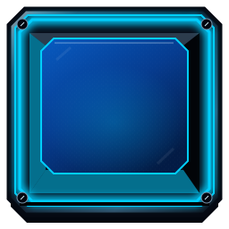

# CAPTCHA AI — графічна бібліотека

Окремі ресурси для браузерної логічної гри «Доведи, що ти людина!». Візуальний напрям узято з п’яти наданих референсів: CRT-корпус, механічні клавіші, темний екран, електричний синій і cyan, білий робот, легкий IT-комікс.

Це бібліотека графіки та демонстраційні композиції. Тут немає алгоритму головоломки, таймера, нарахування балів, переходів між рівнями або реальної реєстрації. Початкову бібліотеку `zazino-runner-demo/` не змінено.

## Відкрити

Усі шрифти, стилі, скрипти та зображення локальні; доступ до інтернету не потрібен. Запустіть із кореня репозиторію:

```sh
python3 -m http.server 8000 --directory public/assets
```

Відкрийте шлях `/preview.html` на порту 8000 локального сервера. Каталог вбудовано в `asset-catalog.js`, тому він не потребує fetch. Прямий `file://` у цьому середовищі блокує адміністративна політика Chromium; цей спосіб тут не підтверджено. Окремі композиції: `screens/intro.html`, `training.html`, `main.html`, `popup.html`, `results.html`. Для перегляду окремих екранів без панелей галереї використовуйте ці файли. Усі вони зібрані з тих самих компонентів у `preview.js`, а не з плоских знімків референсів.

## Склад

| Каталог | Вміст / базовий розмір |
| --- | --- |
| `backgrounds/` | Ілюстрована майстерня, темна термінальна підкладка, підкладка екрана |
| `monitor/` | Деталізований CRT-корпус 1920×1080 із прозорим отвором, окреме скло, три стікери |
| `keycaps/` | Сім станів 256×256, два прозорі шари освітлення, специфікація полів |
| `buttons/` | Шість типів × чотири стани, 480×104, без написів |
| `panels/` | 14 панелей: HUD, таймер, рахунок, рівень, ходи, команда, повідомлення, правила, модальні вікна й картки результатів |
| `icons/` | 14 SVG-іконок, 32×32 |
| `mascot/` | 10 окремих PNG із прозорістю та компактний піксельний робот 32×40 |
| `comics/` | Дві ілюстрації студентів, рамка сцени, порожні speech/thought bubbles, паперова панель |
| `popups/` | Успіх, відкладений рівень, завершення часу, усі рівні завершено, підтвердження пропуску |
| `effects/` | Scanlines, імпульс клавіші, промені успіху, затемнення |
| `screens/` | П’ять демонстраційних HTML-композицій із редагованим текстом |
| `fonts/` | Локальний DejaVu Sans із кирилицею та ліцензією |

Точні фактичні розміри, формати, призначення, прозорість, SHA-256 та залежності записані в `assets_manifest.json`. Цей manifest перелічує всі графічні ресурси й супровідні runtime-файли; `README`, QA та сам manifest є метаданими пакета й зазначені окремо. `asset-catalog.js` є згенерованою копією переліку графіки для офлайн-галереї.

## Дизайн-система

`design-tokens.json` містить палітру, координати отвору CRT, розміри й тривалості анімацій. Кольори: фон `#020a16`, текст `#e6f4ff`, неактивний текст `#9eb7d2`, cyan `#00cfff`, синій `#1688ff`, зелений `#36efa6`, помаранчевий `#ffa531`, червоний `#ff5269`.

Основні декоративні деталі залишаються на корпусі й поза полем. Текстові блоки та підписи не входять у растрові зображення. Єдині змістові знаки в ілюстраціях — зелена галочка та червоний хрест на планшеті робота; вони є частиною відповідної емоції.

## Клавіші — повторне використання

Один комплект поверхонь обслуговує A–Y. Не потрібні 25 окремих зображень. `inactive`, `active`, `hover`, `pressed`, `toggled`, `disabled`, `success` мають однаковий canvas 256×256 і перспективу. Накладайте літеру через HTML, орієнтир центру напису — `(128,120)`, базовий розмір 88px на 256px canvas.

```html
<button type="button" class="keycap" data-state="active"
        aria-label="Клавіша A, активна" aria-pressed="true">
  
  <span>A</span>
</button>
```

При зміні стану синхронно змініть `data-state`, `src`, `aria-pressed` та доступну назву; для недоступної клавіші встановіть HTML `disabled`. При переході до `hover` або `pressed` майбутня гра повинна пам’ятати логічний active/inactive і відновлювати його після pointerleave/pointerup. У галереї зразки навмисно показують усі стани одночасно, а click запускає лише декоративний імпульс.

Альтернативний спосіб: корпус `inactive.svg` + `light-blue.svg` / `light-green.svg` + напис. `effects/key-pulse.svg` накладається останнім. Сім готових state-SVG зручні для прямого перемикання без композиції шарів.

Поля 3×3, 4×4, 5×5 використовують спільний квадрат 565px, CSS Grid та змінну `--n`. Перелік літер і формули — у `keycaps/grid-layouts.json`. Усі keycaps залишаються квадратними; зменшується вся клавіша разом із літерами. Ніяких вирізань із референсу із сусідніми елементами немає.

## Масштабування й композиція

Кожен екран має логічне полотно 1920×1080. Прозорий отвір CRT починається в `(100,100)` і має розмір 1720×870. Компоненти інтерфейсу розміщуйте всередині нього, корпус і скло накладайте окремими шарами з `pointer-events:none`.

Галерея використовує ResizeObserver та рівномірний scale; пропорції, відступи й перспектива клавіш не змінюються. Перевірено 1920, 1280 та 960px; галерея компонентів також адаптується до 390px. На вузькому телефоні загальний екран 16:9 є оглядовою мініатюрою: для читання тексту відкрийте композицію окремо й збільште або використайте альбомну орієнтацію. Для майбутньої гри з керуванням на телефоні потрібне окреме адаптивне компонування; цей пакет не заявляє перевірку сенсорного геймплею.

При демонстрації в Discord/Meet бажано 1280×720 або більше, масштаб браузера 100%, демонстрація окремої композиції. Для панелей і кнопок SVG має `preserveAspectRatio="none"`, тому поверхні заповнюють свої контейнери без порожніх смуг. Не стискайте їх до стану, коли фаски або рамки стають нерозбірливими. Іконки та маскот використовуйте з `object-fit:contain`.

Ілюстрований фон має фактичний розмір, записаний у manifest; він масштабується в композиції через cover. Не видається за нативний 1920×1080 оригінал. SVG-геометрія не залежить від роздільності.

## Рекомендовані анімації

- Hover: 140ms, легке підсилення світла без зміщення поля.
- Pressed: 85ms, натискна поверхня й літера опускаються разом.
- Toggled: один імпульс 320ms, без нескінченного блимання.
- Success: 600ms, послідовний зелений акцент із затримкою 25–40ms між клавішами.
- Маскот: за потреби легке зміщення 2–3px, без розтягування або деформації; емоції перемикайте готовими зображеннями.
- Scanlines: нерухомі й низькоконтрастні. У CSS враховано `prefers-reduced-motion`.

## Важливі правила для майбутньої реалізації

- Тренування: 3×3, без таймера, балів і включення до загального часу. Зелений перехід заблокований до виконання умови.
- Основна гра: 4 залікові рівні по 25 балів, разом 100; налаштовуваний безперервний таймер, ліміт ходів на спробу, необмежені повторні спроби та скасування останнього ходу.
- Є лише «Скасувати хід», «Скинути рівень», «Пропустити рівень»; кнопок «Пауза» та «Правила» в основній композиції немає.
- Пропуск відкладає рівень, а не видаляє його. Після наступних рівнів потрібне повернення до непройдених; цей поведінковий механізм належить наступному етапу. Компоненти відкладеного стану та підтвердження тут підготовлені.
- Попап успіху — окремий DOM-шар над композицією гри. Затемнення не містить зображення ігрового поля.
- Підсумки підтримують 0, 25, 50, 75, 100 балів і завершення часу до проходження всіх рівнів. Є статуси «Пройдено», «Не пройдено», «Пропущено», «Не встигли».
- Лише 100/100 показує підтвердження людяності й розблоковану реєстрацію. Сюжетна реєстрація — div без href і без мережевого запиту.
- Нижні елементи результатів: «На головну», «Пройти ще раз», «Результати у PNG». Кнопки «Завершити гру» немає.

## Майбутній експорт результатів у PNG

Експортувати потрібно результат 1920×1080 після `document.fonts.ready` та повного декодування зображень. У кадрі мають бути команда, рахунок `/100`, усі чотири картки зі статусами, загальний час, ходи та правильне завершення історії. Врахуйте стан timeout та довгі назви команд. Панелі галереї й контролери прикладів у PNG не входять.

У цьому пакеті є поверхня кнопки та повністю зібраний DOM результату. Сам експорт і прив’язка до стану гри не реалізовані. Перевірку реального завантаження PNG слід виконати на наступному етапі розробки гри.

## Ілюстрації та походження

Складні ілюстрації створено інструментом генерації зображень на основі п’яти наданих користувачем референсів. Спочатку створено один master-маскот `neutral.png`, дев’ять інших станів отримано з посиланням на нього. Збережені характерні білий корпус, синє обличчя, cyan-очі, дві антени, круглі вуха, сегментовані кінцівки. PNG мають справжній alpha, а не намальовану шахівницю. М’яке крайове світло й субпіксельний alpha є частиною ілюстрації.

Дві ілюстрації студентів — окремі вирізні групові композиції, а не вирізані пікселі референсу. Вони придатні для накладання на довільну рамку. Клавіші, корпус монітора, кнопки, панелі, іконки й ефекти створено як оригінальну SVG/CSS-геометрію. Повні референсні екрани в runtime не використовуються. Деталі походження та SHA-256 референсів: `SOURCE_PROVENANCE.json`.

## Перевірка та межі готовності

`QA_REPORT.md` і `QA_RESULTS.json` містять результати фактичного декодування, перевірки manifest, прозорості, рендерингу SVG та браузерних сценаріїв. Вони не є перевіркою проходження рівнів. Знімки композицій у QA зберігаються окремо від reusable графіки, щоб не сплутати їх із шарами гри.

Графічний набір готовий для інтеграції. Перед випуском самої гри залишаються перевірка кінцевої адаптивної верстки, поведінки рівнів, таймера, touch/keyboard керування, доступності та реального PNG-експорту. Зовнішня генерація для запитаних ілюстрацій більше не потрібна.
